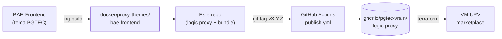

# Business Ecosystem Logic Proxy — fork PGTEC

Fork de [FIWARE-TMForum/business-ecosystem-logic-proxy](https://github.com/FIWARE-TMForum/business-ecosystem-logic-proxy)
que sirve el **marketplace de PGTEC** (VRAIN, UPV). El *logic proxy* es el punto de entrada del
Business API Ecosystem: autentica a los usuarios, valida las peticiones hacia las APIs TMForum y
sirve la web del marketplace.

<<<<<<< HEAD
## Cómo funciona este repo
=======
 * [Introduction](#introduction)
 * [GEi Overall Description](#gei-overall-description)
 * [Installation](#installation)
 * [Customizing the Marketplace Theme](#customizing-the-marketplace-theme)
 * [API Reference](#api-reference)
 * [Testing](#testing)
 * [Advanced Topics](#advanced-topics)

# Introduction

This is the code repository for the Business Ecosystem Logic Proxy, one of the components that made up the [Business API Ecosystem GE](https://github.com/FIWARE-TMForum/Business-API-Ecosystem). The Business API Ecosystem is part of [FIWARE](https://www.fiware.org), and has been developed in collaboration with the [TM Forum](https://www.tmforum.org/).

Any feedback is highly welcome, including bugs, typos or things you think should be included but aren't. You can use [GitHub Issues](https://github.com/FIWARE-TMForum/business-ecosystem-logic-proxy/issues/new) to provide feedback.

| :books: [Documentation](http://business-api-ecosystem.readthedocs.io) | :whale: [Docker](https://registry.hub.docker.com/r/fiware/biz-ecosystem-logic-proxy) |  [quay.io](https://quay.io/repository/fiware/biz-ecosystem-logic-proxy) |
 | ------------------------------------------------------------------------------------ | ---------------------------------------------------------------------------- | --- |

# GEi Overall Description

The Business API Ecosystem is a joint component made up of the FIWARE Business Framework and a set of APIs (and its reference implementations) defined by the TMForum. This component allows the monetization of different kind of assets (both digital and physical) during the whole service life cycle, from offering creation to its charging, accounting and revenue settlement and sharing. The Business API Ecosystem exposes its complete functionality through TMForum standard APIs; in particular, it includes the catalog, management, ordering management, inventory management, usage management, billing, customer, and party APIs.

In this context, the Business Ecosystem Logic Proxy acts as the endpoint for accessing the Business API Ecosystem. On the one hand, it orchestrates the APIs validating user requests, including authentication, authorization, and the content of the request from a business logic point of view. On the other hand, it serves a web portal that can be used to interact with the system.

# Installation

The Business Ecosystem Logic Proxy is installed as part of the Business API Ecosystem, so the instructions to install it can be found at [the Business API Ecosystem Installation Guide](http://business-api-ecosystem.readthedocs.io/en/latest/installation-administration-guide.html). You can install the software in two different ways:

* Using a [Docker Container](https://hub.docker.com/r/fiware/biz-ecosystem-logic-proxy/) (recommended)
* Manually

# Customizing the Marketplace Theme

The web portal served by the Logic Proxy (`portal/bae-frontend`) is the compiled build of the
[BAE Frontend](https://github.com/Ficodes/BAE-Frontend). If you want to create your own theme for the
Marketplace (colors, logos, navigation links, texts, etc.), refer to the BAE Frontend repository: its
README explains how to create a new theme and how to build a Logic Proxy image that includes it.

The theme to be used is selected at runtime with the `BAE_LP_THEME` environment variable.

# API Reference

For further documentation, you can check the API Reference available at:

* [Apiary](http://docs.fiwaretmfbizecosystem.apiary.io)
* [GitHub Pages](https://fiware-tmforum.github.io/Business-API-Ecosystem/)

# Testing

To execute the unit tests, just run:
>>>>>>> upstream/master



1. **Frontend.** La web es una app Angular de [PGTEC-VRAIN/BAE-Frontend](https://github.com/PGTEC-VRAIN/BAE-Frontend).
   Su build compilado se guarda en `docker/proxy-themes/bae-frontend` (ver
   [`docker/proxy-themes/README.md`](docker/proxy-themes/README.md) para regenerarlo). No se edita a mano.
2. **Imagen.** `docker/Dockerfile` instala el proxy y copia ese bundle en `portal/bae-frontend`, que es lo que
   `server.js` sirve como web.
3. **Publicación.** El workflow [`.github/workflows/publish.yml`](.github/workflows/publish.yml) se dispara al subir un
   tag `vX.Y.Z`, construye la imagen (amd64 + arm64) y la sube a `ghcr.io/pgtec-vrain/logic-proxy`
   con el tag de la versión y `latest`.
4. **Despliegue.** La imagen se despliega con Terraform en la VM de la UPV.

### Sacar una versión nueva

```bash
git tag v1.2.3 && git push origin v1.2.3   # el workflow construye y publica la imagen
```

## Cambios respecto a Fiware

- **Login con certificado (FNMT)** mediante wallet custodiada (`BAE_LP_WALLET_URL`, `BAE_LP_WALLET_VERIFIER_KEY`,
  `BAE_LP_WALLET_SCOPE`) además del login VC con verifier (QR). Si `BAE_LP_WALLET_URL` está vacío, solo el flujo con verifier.
- **Verifier:** se envía `state` (necesario para Lissi Wallet) y no se envía `request_uri`.
- **Contract management:** la URL aparece en el perfil del vendedor.
- **Avisos por correo** (`lib/notifications.js`, `lib/mailer.js`): solicitudes y cambios de estado de pedidos y resumen
  mensual. Desactivado por defecto; se activa con `BAE_LP_MAIL_ENABLED=true` y un SMTP (`BAE_LP_MAIL_*`).
- **Tema PGTEC** (`BAE_LP_THEME=PGTEC`), idiomas es/en, logos y estilos (viven en el bundle del frontend).
- **CI:** imagen en GHCR en lugar de Docker Hub/Quay. El workflow necesita el secreto `GHCR_PAT`.

## Ramas

| Rama | Uso |
|------|-----|
| `main` | Rama de trabajo y de la que se sacan los tags. |

Para traer cambios de Fiware: `git fetch upstream` y fusionar de forma selectiva en una rama aparte
(el remoto `upstream` es el repo original).

## Desarrollo local

```bash
npm install
npm test
```

La configuración se hace con variables `BAE_LP_*` (ver `config.js`). Ejemplo de arranque con MongoDB en
[`docker/docker-compose.yml`](docker/docker-compose.yml). Nota: `portal/bae-frontend` no está en el repo; se
rellena al construir la imagen, así que para ver la web hay que usar Docker.

## Documentación de Fiware

[Business API Ecosystem](http://business-api-ecosystem.readthedocs.io) ·
[Guía de instalación](https://github.com/FIWARE-TMForum/Business-API-Ecosystem/blob/master/doc/installation-administration-guide.rst).
Licencia AGPL-3.0 (ver `LICENSE.txt`).
